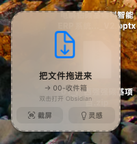

# ObsidianDrop

**把「还没进知识库」的东西，用最短路径送进 Obsidian。** 一个常驻菜单栏的 macOS 小窗：文件拖进去、屏幕框一下、话说完点一下——笔记和附件自动落进你指定的目录，frontmatter 都填好了。

[]()
[]()
[]()
[](LICENSE)



---

## 它解决什么

记账式的知识管理最难的不是整理，是**入口**：一条灵感出现在微信里、在浏览器里、在你嘴里，等你打开 Obsidian、想好放哪、命名、补 frontmatter，它已经凉了。

ObsidianDrop 把这一步压成一个动作：**拖／截／说**。库外的东西进库，不需要切应用、不需要选目录、不需要写字段。

```
拖文件 ─┐
截  图 ─┼→ 悬浮小窗（常驻桌面）→ 判定目标 → 复制/落盘 → 写笔记（frontmatter + 附件嵌入）→ 进库
说  话 ─┘                                    ↑
                                    菜单栏可随时切换投递目标
```

## 功能

| 功能 | 说明 |
|---|---|
| **拖拽归档** | 从访达 / 微信 / 浏览器把文件或整个文件夹拖到小窗上，松手即归档；支持多选 |
| **截屏归档** | 区域 / 整屏 / 单窗口 / 只进剪贴板，四种模式；截屏时小窗自动收纳，不会把自己拍进图里 |
| **语音灵感** | 点一下开始录音，再点一下结束；端上转写，**音频不出本机**；带实时百分比进度、0 字诊断、音量呼吸反馈 |
| **自动写笔记** | 每次投递生成一篇 `YYYY-MM-DD 名称.md`，附件按月归档到 `附件/YYYY-MM/`，正文用 `![[...]]` 嵌入 |
| **多目标切换** | 菜单栏随时切换落库目录（默认 `00-收件箱`），设置持久化 |
| **开机自启** | 基于 `SMAppService`，菜单栏一键开关 |
| **可诊断** | 内置 `--audio-check` / `--self-test` / `--ui-memo` 等命令，出问题先自证，不用猜 |

## 生成的笔记长什么样

```markdown
---
类型: 灵感速记
创建时间: 2026-11-03 15:48
时长: 1:13
目标: 00-收件箱
转写: 端上本机（DictationTranscriber / 中文）
tags:
  - 灵感
  - 收件箱
---

# 灵感 2026-11-03 15:48

这是第一条灵感：MES 上线前要把压力测试脚本准备好。

> [!note] 录制信息
> - 时长：1:13
> - 转写：Mac 本机完成，未上传云端
```

字段名是**稳定契约**：即使卸载本应用，已归档的笔记与附件仍然完整可用，Dataview 查询也不会坏。

## 它不是 Obsidian 插件

| 常见期待 | 实际情况 | 为什么 |
|---|---|---|
| 是一个 Obsidian 插件 | **不是**。独立 macOS 应用，不读写 `.obsidian/` | 插件只能活在 Obsidian 窗口里；本应用要在**任何** App 之上接受拖拽、截图、录音 |
| 在 Obsidian 里能点按钮 | 没有按钮，也不需要有。靠**文件契约**生效，Obsidian 被动索引 | 少一层依赖，插件冲突与版本升级都不影响它 |
| 能整理、能改我的笔记 | **只新建，不改既有笔记**（写入范围仅限本次投递产生的那一篇） | 自动改写用户笔记是最高风险操作 |
| 云端转写更准 | 端上转写（macOS 26 `DictationTranscriber`），音频不离开本机 | 隐私优先；代价是识别质量受系统语言包影响 |
| 能装在 Intel Mac 上 | 仅 arm64 + macOS 13+；语音功能需 macOS 26+ | 交付范围就是 Apple Silicon |

## 安装

### 方式一：源码构建（推荐，无需 Xcode）

需要 **Xcode Command Line Tools**（`xcode-select --install`）与 Apple Silicon Mac。

```bash
git clone https://github.com/<your-name>/ObsidianDrop.git
cd ObsidianDrop
./build.sh                      # 编译并安装到 ~/Applications
./build.sh /Applications        # 或指定安装目录
```

`./build.sh` 用 `xcrun swiftc` 单文件编译，ad-hoc 签名，秒级完成，**不依赖第三方库**。

### 方式二：dmg

```bash
./package-dmg.sh                # 生成 dist/ObsidianDrop-<版本>.dmg
```

把 app 拖进「应用程序」，**再从应用程序里启动**。别在 dmg 窗口里直接双击——每次挂载路径都不同，系统会当成另一个程序，麦克风/截屏授权会反复失效。首次打开若提示「无法验证开发者」：右键 → 打开 → 再点「打开」。

### 首次权限

| 权限 | 什么时候需要 | 拒绝的后果 |
|---|---|---|
| 麦克风 | 点「灵感」录音 | 无法录音 |
| 屏幕与系统录音 | 点「截屏」 | 截图失败 |
| 完全磁盘访问权限 | 拖入受保护目录的文件 | `Operation not permitted` |

三者都在「系统设置 → 隐私与安全性」。**改完权限要退出重开**（编译后签名会变，系统可能要求重新授权）。

## 命令行

```bash
BIN=/Applications/ObsidianDrop.app/Contents/MacOS/ObsidianDrop
```

| 命令 | 用途 |
|---|---|
| `$BIN --file <路径> [--target <目录>] [--vault <库>] [--json]` | 归档一个文件/文件夹（脚本化投递） |
| `$BIN --shot full\|area\|window\|clipboard [--target <目录>]` | 截图并归档；`clipboard` 只进剪贴板 |
| `$BIN --transcribe <音频> [--target <目录>] [--out <文件>]` | 转写一个音频文件并归档 |
| `$BIN --audio-check [--json]` | 设备与权限诊断（麦克风、语音模型、库路径） |
| `$BIN --self-test` | 106 项内部不变量自检 |
| `$BIN --ui-memo <音频> [--target] [--vault]` | 走**完整界面链路**跑一轮（录音文件→转写→归档→复位），用于自动化验收 |
| `$BIN --render-preview <目录>` | 把面板各状态离屏渲染成 PNG（排查排版问题） |
| `$BIN --login` | 查看 / 切换开机自启状态 |

约定：`--vault` 只影响本次进程，不写偏好，便于用临时库做隔离测试。

## 数据放在哪

| 内容 | 路径 |
|---|---|
| 笔记与附件 | 你选的 Obsidian 库目录内 |
| 录音临时文件 | `~/Library/Application Support/ObsidianDrop/recordings/`（转写成功后删除） |
| 待归档队列 | `~/Library/Application Support/ObsidianDrop/pending/`（`.json`，权限 0600，网络中断也不会丢） |
| 运行日志 | `~/Library/Logs/ObsidianDrop.log` |
| 偏好 | `com.lw.obsidiandrop`（`defaults read` 可看） |

## 设计上的几个硬决定

这个仓库真正有意思的部分，是那些「看起来多此一举」的约束：

- **录音只写文件，不在录的时候喂识别。** 录音与识别彻底解耦：识别引擎没装好、模型还在下、权限没给，录音都不会丢。
- **先落盘，再投递。** 转写结果先原子写入待归档队列（`.tmp` → `rename`，0600），写笔记成功才删音频。任何一环崩了，下次启动自动补归档，不会出现「界面说成功了但笔记没有」。
- **投递不挂在会死的对象上。** 结果用强持有的 sink 投递，不用 `[weak self]`——闭包晚于对象释放执行的话，结果会被静默吞掉。
- **只新建，不改旧。** 写入范围严格限定在本次投递产生的那一篇笔记。
- **状态机 + 看门狗。** 界面卡住不影响落库，看门狗恢复界面并从队列补写。

## 构建与测试

```bash
./build.sh                              # 编译 + 安装
bash scripts/regression.sh              # 56 项回归（自动编译，全在临时库里跑）
BIN=/path/to/ObsidianDrop bash scripts/regression.sh   # 用已有二进制
$BIN --self-test                        # 106 项内部自检
```

回归测试**从不触碰真实 Obsidian 库**：每个用例用 `mktemp` 建临时库并通过 `--vault` 覆盖。

## 已知限制

- 仅 `arm64`（Apple Silicon）+ macOS 13+；语音转写需 macOS 26+ 的端上模型
- 不做实时转写（录音期间界面只显示时长与音量），这是刻意的取舍
- 不做说话人分离、不做笔记双向编辑、不自建同步
- 语音首次使用需系统下载语言包，可能等待数分钟
- 无公证签名（ad-hoc），首次运行需手动放行

更多细节见 [`docs/应用说明.md`](docs/应用说明.md)（架构与插件分工）、[`docs/使用说明.md`](docs/使用说明.md)（逐功能操作手册）。

## 贡献

Issue 与 PR 都欢迎。改动前建议先跑 `bash scripts/regression.sh` 与 `--self-test`：这两处失败通常意味着动到了状态机或落库顺序。

## 许可

[MIT](LICENSE)。语音识别能力由 macOS 系统框架（`Speech`）提供，本项目不附带任何模型文件。
